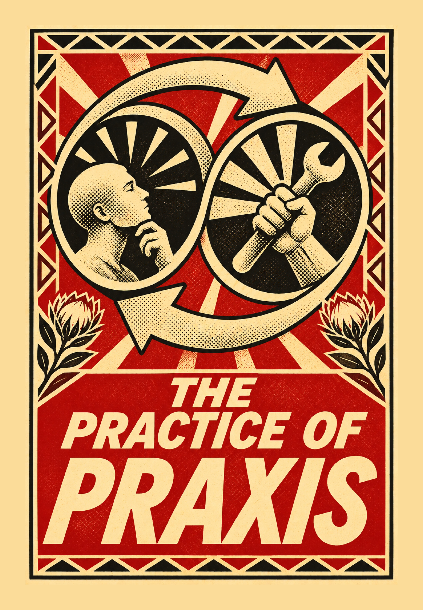
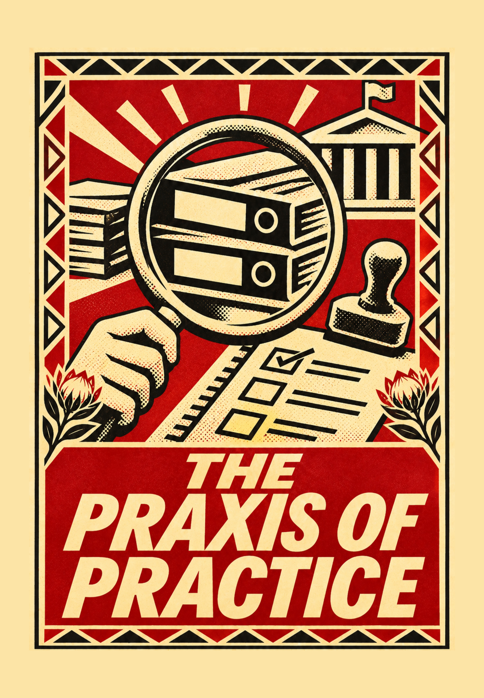
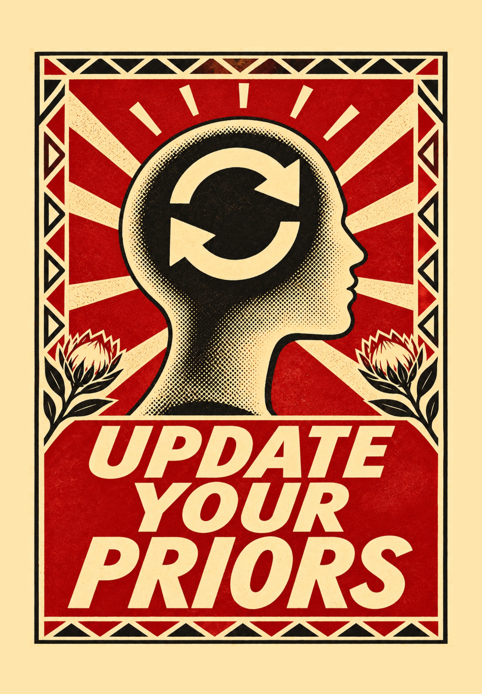
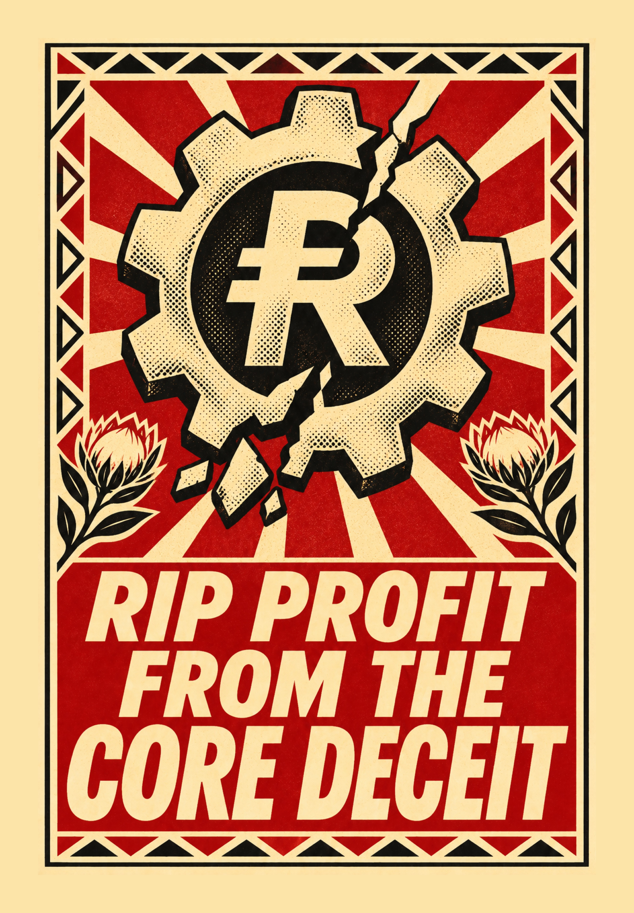
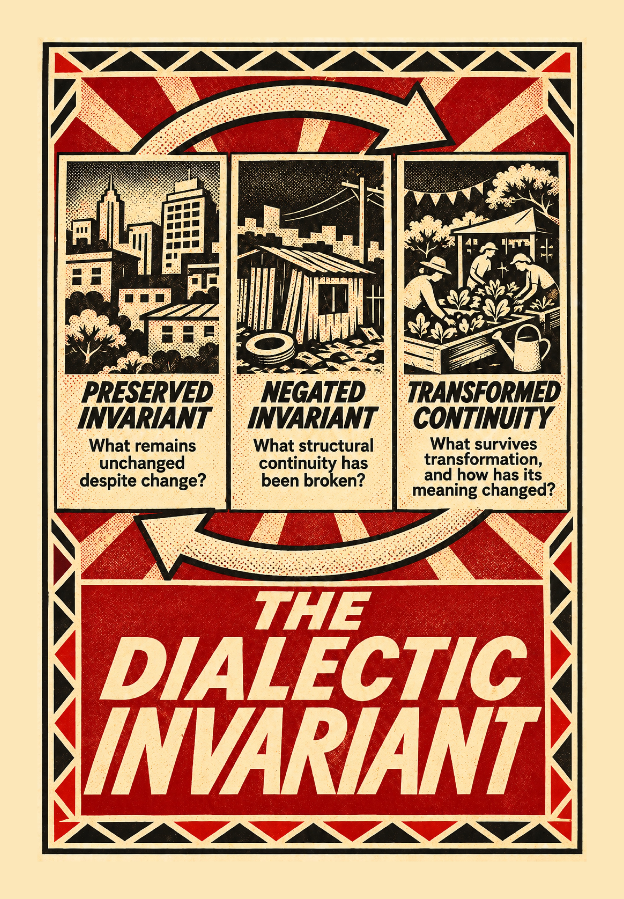
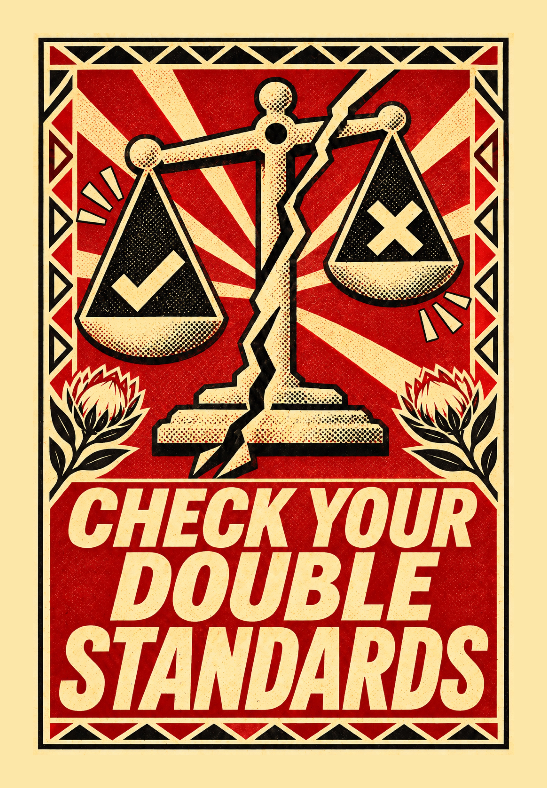
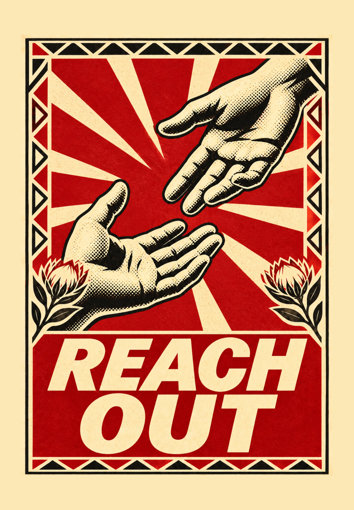

# Refusal and Agency

**Refusal is not always inaction. Sometimes it is where agency begins.**

This is a small collection of stickers about questioning what we take for granted, challenging power, and finding ways to engage with and change the world around us.

The ideas are invitations to think, disagree, reflect, act, and perhaps change our minds.

Take a look. Find something that speaks to you. Share it, question it, or make it your own.

## Stickers

Click a thumbnail to view the full-resolution image.

<table>
<tr>
<td width="33%"></td>
<td width="33%"></td>
<td width="33%"></td>
</tr>
<tr>
<td></td>
<td></td>
<td></td>
</tr>
<tr>
<td></td>
<td></td>
<td></td>
</tr>
</table>

## License

This project is licensed under **Creative Commons Attribution-NonCommercial-ShareAlike 4.0 International (CC BY-NC-SA 4.0)** — see [LICENSE](LICENSE) for the full legal code.

You are free to **share** and **adapt** the material, but you must give appropriate credit, may not use it for commercial purposes, and must distribute any adaptations under the same license.
